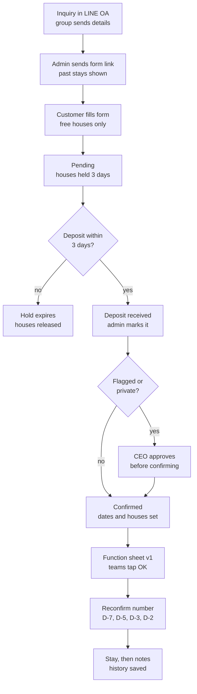

# KRSC Booking Hub — Product Requirements Document

Group 4 InProgress · ITCS368, Mahidol University · 18 Nov 2026

## Overview

The KRSC Booking Hub is one shared booking and customer record for Kaeng Krachan Riverside Resort & Camping (KRSC). It prevents double bookings and wrong houses, gives every team the same plan, and shows a returning group's history at the first message.

**Background.** KRSC is a 60-rai camp resort with 24 houses and shelters. It serves Scout groups, school and youth camps, companies and individual guests, about 19,500 guests a year. About 75% of groups return every one to three years. Most bookings arrive through the LINE Official Account (LINE OA).

**Problem.** Booking data is typed into 7 places: the booking sheet, the calendar, printed documents, the function sheet, and Doc, Excel and paper history files. The CEO checks every booking by hand after it is confirmed. Four high-priority issues follow:

| ID | Issue | Root cause |
| --- | --- | --- |
| P1 | Duplicate-booking control depends on the CEO's manual check | No shared record (RC1), control held by few people (RC4) |
| P3 | Wrong house prepared for a group | No shared record (RC1), informal hand-offs (RC2) |
| P2 | OTA bookings cannot be accepted safely | Booking channels not connected (RC3) |
| P7 | Customer history is lost or never read | No shared record (RC1) |

Guest numbers are also reconfirmed only one day before arrival (P6). In one case 400 were booked and 300 came, so about 700 meals were wasted.

**Source.** Group 4 InProgress, *Project Final* report (ITCS368, Mahidol University), Sections 1, 4 and 6, based on five owner interviews from August to October 2026.

## Goals and success metrics

Version 1 succeeds when no booking is double-booked or prepared in the wrong house, booking details are typed once, and every team gets the final guest number two days before arrival.

**Goals**

1. One shared booking and customer record replaces the 7 places where details are typed today.
2. The system blocks house conflicts before a booking is confirmed, so the CEO reviews only flagged and private bookings.
3. Every team receives the same versioned function sheet and confirms it with "OK".
4. Reconfirmation runs from D-7 to D-2, so the kitchen buys for the real number.
5. A returning group's past stays appear when the admin starts a new inquiry.

**Non-goals for version 1**

- OTA bookings (Agoda, Booking.com) and a channel manager. Version 1 creates the single record they will need later.
- Online payment. The deposit is still paid by bank transfer.
- The AI assistant in the LINE OA (Premium level).
- Café orders, finance, receipts and accounting.

**Success metrics** (from report Table 23; "today" figures are from the owner interviews)

| KPI | Today | Target | How it is measured |
| --- | --- | --- | --- |
| Wrong-house cases per month | Not measured | 0 | Admin logs each case |
| Duplicate bookings per month | Not measured; rare | 0 | Conflict log in the system |
| Gap between booked and arriving guests | Up to 25% (400 booked, 300 came) | Within 5% | Number at D-2 vs. trainers' count on arrival |
| Places where booking details are typed | 7 | 1 | Count of documents in use |
| Bookings checked by the CEO | All, after confirmation | Flagged and private only, before confirmation | System count |
| Teams that reply "OK" within 2 hours | Not measured | 100% | Reply time in the system |
| Returning groups whose history is seen at the first message | 0% | 100% | System check |
| Time from first message to quotation | 10 minutes to 3 hours | Same working day | Response-time field |

## Users and permissions

Five roles use the system. Staff log in; customers never log in and use a private link instead.

| Role | Who | Main job in the system | Can see | Can change |
| --- | --- | --- | --- | --- |
| CEO | Owner | Approve flagged and private bookings; watch the today page | Everything | Approvals, private-booking blocks, prices |
| Admin | Booking admin (plus one back-up) | Run each booking from inquiry to check-out | All bookings, customers, houses | Bookings, quotations, deposit status, house allocation, function sheets |
| IT manager | In-house IT manager (system owner) | Keep the system running; first line of support | Everything | User accounts, house list, program templates, settings |
| Team head | Trainers, venue, housekeeping, kitchen, finance | Prepare for each group and confirm with "OK" | Today's tasks of **all** teams (read-only), so teams can coordinate | "OK" and "done" on **their own team's** tasks only |
| Customer | Teacher or group leader | Fill in the booking form once; reconfirm the guest number | Their own booking only, through the link | Their own form until the admin confirms it |

Team heads see other teams' tasks because their work depends on each other, for example the kitchen needs the trainers' count. Contact phone numbers stay hidden from team heads (PDPA); food allergies are shown to the kitchen and trainers.

## Scope and release plan

This PRD specifies the **Standard** level: a KRSC web system built by a freelancer. Starter (Google Sheet) runs first as Phase 0, and Premium (AI assistant) is future work.

**Clickable prototype:** [xiangbibi.github.io/krsc-booking-hub](https://xiangbibi.github.io/krsc-booking-hub). This is the prototype shown to the owner. It is the visual reference for the screens in this PRD: booking page, calendar, customer record, team page and AI helper (the AI helper is future work). Where the prototype and this PRD differ, this PRD wins; for example, in the real system the booking page opens only from the admin's link.

| Level | Role in this PRD | Built by | One-time cost | Monthly cost |
| --- | --- | --- | --- | --- |
| Starter: Google Sheet, Google Form, LINE OA | Phase 0. Rules and data habits start here; its data moves into Standard | In-house IT manager | 0 baht | 0–1,280 baht |
| **Standard: KRSC web system** | **Version 1, the subject of this PRD** | Freelancer (Fastwork) or web company | Estimate 50,000–100,000 baht | About 2,600–5,300 baht |
| Premium: Standard + AI assistant | Future, after Standard is stable | Vendor + ready-made chatbot service | Estimate 70,000–165,000 baht | About 3,100–8,300 baht |

Costs are the team's estimates from report Table 20 (Thai market prices, November 2026). The resort should collect real quotes from at least three freelancers.

**In scope for version 1**

- Online booking form, opened only from a link the admin sends
- House-by-date availability with automatic conflict blocking and a private-booking block
- Back office: today page, calendar, bookings list, customer records, house list
- Deposit status in the back office: the customer still sends the slip in the LINE chat; the admin marks the deposit as received (attaching the slip is optional)
- Generated, versioned function sheet with program templates
- Team task page and LINE notifications with "OK" replies
- Reconfirmation schedule D-7, D-5, D-3, D-2
- Customer history and a lessons-learned form after check-out

**Out of scope for version 1:** OTA connection, online payment, AI assistant, café, finance and receipts.

## Functional requirements

Version 1 has 27 requirements: 23 are Must and 4 are Should. Should items can be cut first if the budget runs short. Each acceptance criterion is what the resort tests before it pays the final installment.

**A. Inquiry and booking form**

| ID | Requirement | Priority | Acceptance criteria |
| --- | --- | --- | --- |
| FR-01 | Admin creates an inquiry (organization, contact, phone, LINE ID, dates, approximate guests, camp type) and the system makes a private form link to send in the LINE OA | Must | Each link is unique, opens on a phone without login, and stops working when the booking is cancelled or its hold expires |
| FR-02 | When the admin types an organization, phone number or LINE ID, the system shows matching past stays, houses, food allergies and notes | Must | Matches appear within 2 seconds; the last 3 stays are shown |
| FR-03 | The customer fills in one form: contact, guest numbers (students and adults), arrival time, nights, meals, food allergies, optional activities and PDPA consent | Must | The form cannot be sent until required fields and consent are complete |
| FR-04 | The form shows only houses that are free for the chosen dates, with each house's capacity | Must | Houses that are booked, on hold or under a private block cannot be chosen |
| FR-05 | The form shows an estimated price per person from the package price the admin sets; the final price is in the admin's quotation | Should | The estimate is visible only through that customer's link |
| FR-06 | The customer form switches between Thai and English | Must | Every label and message on the form exists in both languages |

**B. Availability, holds and approval**

| ID | Requirement | Priority | Acceptance criteria |
| --- | --- | --- | --- |
| FR-07 | A submitted form creates a booking with status Pending and holds the chosen houses. The hold lasts 3 days by default; the admin can change it | Must | An expired hold releases the houses and notifies the admin |
| FR-08 | The system never allows two active bookings in the same house on overlapping nights | Must | Two forms sent at the same moment for the same house: only one succeeds, the other is asked to choose again |
| FR-09 | The CEO can set a private booking that blocks all 24 houses for a date range | Must | No form or admin action can add another booking in those dates |
| FR-10 | Flagged bookings (private, special requests, admin override) wait in a CEO approval queue before confirmation | Must | A flagged booking cannot be confirmed without CEO approval |

**C. Quotation and deposit**

| ID | Requirement | Priority | Acceptance criteria |
| --- | --- | --- | --- |
| FR-11 | Admin records the quotation amount and the date it was sent (the quotation itself is still made in Google Docs) | Should | The bookings list shows the quoted amount and its age in days |
| FR-12 | The customer still sends the slip in the LINE chat; the admin marks the 50% deposit as received (attaching the slip is optional) | Must | Marking the deposit stops the hold timer and changes the status to Confirmed |

**D. Function sheet and teams**

| ID | Requirement | Priority | Acceptance criteria |
| --- | --- | --- | --- |
| FR-13 | The system generates the function sheet from the booking and the program template, with the booking ID and a version number | Must | Every change to number, house or program creates a new version; old versions stay readable |
| FR-14 | Each camp type has a program template with fixed activities (for example, the campfire and base activities) pre-filled | Must | The IT manager can edit templates without the developer |
| FR-15 | On confirmation or any change, each team's LINE group gets a short message with a link to the team task page | Must | Messages arrive within 5 minutes of the change |
| FR-16 | Team task page: every team head sees today's tasks of all teams (read-only) and taps "OK" on their own team's tasks | Must | Admin sees who has not replied; teams with no "OK" after 2 hours are flagged |
| FR-17 | A team can mark a task "done" (for example, "House A ready"), and other teams see it | Should | The status shows on the today page within 1 minute |

**E. Reconfirmation**

| ID | Requirement | Priority | Acceptance criteria |
| --- | --- | --- | --- |
| FR-18 | At D-7 and D-5 the system sends the customer a LINE message with a link to confirm or change the guest number. At D-3 it lists unanswered groups for the admin to call. At D-2 it locks the number, creates a new function sheet version and notifies the teams | Must | With no reply by D-2, the booked number is kept and marked "to be counted on arrival" |

**F. Back office**

| ID | Requirement | Priority | Acceptance criteria |
| --- | --- | --- | --- |
| FR-19 | Today page: guests and groups on site, arrivals, departures, open tasks and missing "OK" replies | Must | Loads in under 3 seconds on a phone |
| FR-20 | Calendar of house × date showing which group stays where | Must | Pending, confirmed and private blocks have different colours |
| FR-21 | Bookings list filtered by status: Pending, Confirmed, Reconfirmed, Checked out, Cancelled | Must | Each booking shows deposit and reconfirmation status |
| FR-22 | Customer records with all past stays | Must | One customer record per organization, linked to every booking |
| FR-23 | House list with name, capacity and notes for the 24 houses and shelters | Must | The IT manager can add, edit or retire a house |

**G. History and data**

| ID | Requirement | Priority | Acceptance criteria |
| --- | --- | --- | --- |
| FR-24 | After check-out, a short lessons-learned form linked to the booking ID is saved to the customer record | Must | The notes appear in FR-02 at the next inquiry |
| FR-25 | All data can be exported to Excel or CSV | Must | Export includes bookings, customers, houses and history |
| FR-26 | Import of the Starter Google Sheet data | Must | All future bookings and customer history from Starter appear correctly |
| FR-27 | KPI counts: wrong-house log, booked vs. arrived gap, "OK" reply times | Should | Monthly figures can be exported |

## Key user flow

The customer types the details once, through the admin's link. Houses stay on hold for 3 days; an unpaid hold releases them, and a flagged or private booking needs the CEO's approval before it is confirmed. After confirmation the function sheet, reconfirmation and history steps run from the same record.

## Non-functional requirements

The system must work on a phone, protect customer data under the PDPA, and stay usable on the arrival day even if the internet fails.

| Area | Requirement |
| --- | --- |
| Devices | Customer form and team task page are phone-first (Android and iPhone, current Chrome and Safari). Back office works on phone and computer. |
| Language | Customer form: Thai and English with a switch. Back office and team pages: Thai. |
| Ease of use | A team head can use the team page after a 15-minute demo. Staff training for the whole system takes no more than 1 hour. |
| Performance | Pages load in under 3 seconds on a 4G phone. |
| Accounts and security | Every staff member has their own login; no shared passwords. Permissions follow the roles table. All pages use HTTPS. |
| PDPA | Consent is asked in the form. Contact phone numbers are hidden from team heads. Customer records are kept for 3 years after the last stay, then deleted or anonymized. |
| Backup | Automatic daily backup, kept for at least 30 days. The IT manager can restore it. |
| Arrival-day fallback | The latest function sheet can be printed as a one-page PDF at D-2, in case the internet or the system is down. |
| LINE | Uses the resort's existing LINE OA and the LINE Messaging API. The developer must check that the monthly message volume fits the resort's LINE OA plan. |
| Ownership | The domain, hosting and LINE OA accounts are registered in the resort's name. The resort owns the source code and the data. |
| Maintenance | The in-house IT manager is the system owner and first line of support. The developer fixes bugs free for 3 months after go-live; after that, fixes are paid per job or under a maintenance contract. |

## Budget, timeline and hand-over

The Standard system is built in the low season, March to August 2027, and must be in use before the peak season starts on 1 September 2027.

**Budget.** The one-time build is budgeted at 50,000–100,000 baht. Running costs are about 2,600–5,300 baht a month. Fastwork package prices start lower, but those are sellers' starting prices; a system of this scope is expected to cost 50,000–100,000 baht or more. The resort should compare at least three quotes and pay in stages, for example 30% at start, 40% at a working demo and 30% after acceptance.

**Timeline**

1. **Now to February 2027 (peak season):** Phase 0. Run Starter (Google Sheet with conflict check) and the D-7 to D-2 reconfirmation rule. Start counting the KPIs.
2. **February 2027:** Send this PRD and the clickable prototype to at least three freelancers and choose one.
3. **March–July 2027:** Build. Monthly demo to the admin and the IT manager.
4. **August 2027:** Import Starter data, train staff, and run a 2-week trial with real bookings.
5. **1 September 2027:** Go live. Stop using the old calendar, printed documents and separate history files.

**Acceptance: the work is done when all of these pass**

- [ ] A double-booking test is blocked in 100% of attempts (FR-08)
- [ ] All Must requirements pass their acceptance criteria
- [ ] Starter data is imported completely (FR-26)
- [ ] The admin and every team head use the system for 2 weeks with real bookings
- [ ] The resort receives the source code, all admin passwords, the domain and hosting in its own name, and a short user and maintenance guide

## Risks and open questions

The biggest risks are people, not technology: staff keeping old habits and the system depending on one person.

| Risk | Likelihood | Impact | Mitigation |
| --- | --- | --- | --- |
| Staff keep writing on paper or in chats | High | High | Start with Starter; 1-hour training; one-page guide; the CEO uses the system first |
| The system depends on the IT manager alone | Medium | High | Train one back-up admin; maintenance guide; developer warranty |
| Teachers prefer to send details in chat | Medium | Medium | Short phone form sent in the LINE chat; the admin can fill it in for them |
| Team heads do not tap "OK" | Medium | Medium | Missing replies are flagged; the admin calls after 2 hours |
| Internet or system down on arrival day | Low | High | Print the latest function sheet at D-2 |
| Data kept in old and new tools at once | High | Medium | Move only future bookings; fixed date to stop the old tools |
| Customer data breaks the PDPA | Medium | High | Consent in the form; role-based access; 3-year retention |
| Build costs more or takes longer | Medium | Medium | Pay in stages; the prototype and this PRD as the specification; build in the low season |
| The developer stops supporting the system | Low | High | Code, passwords and domain handed over; data can always be exported |

Risks are from report Table 24, adjusted to version 1.

**Open questions for the owner**

- [ ] Package prices to show as the estimate per person for each camp type
- [ ] Is a 3-day hold before the deposit right for the business?
- [ ] Which LINE OA plan does the resort use, and does it cover the reconfirmation and team messages?
- [ ] Which teams get their own LINE group and task page (trainers, venue, housekeeping, kitchen, finance)?
- [ ] Is keeping customer records for 3 years acceptable?
- [ ] Who is the back-up admin?
